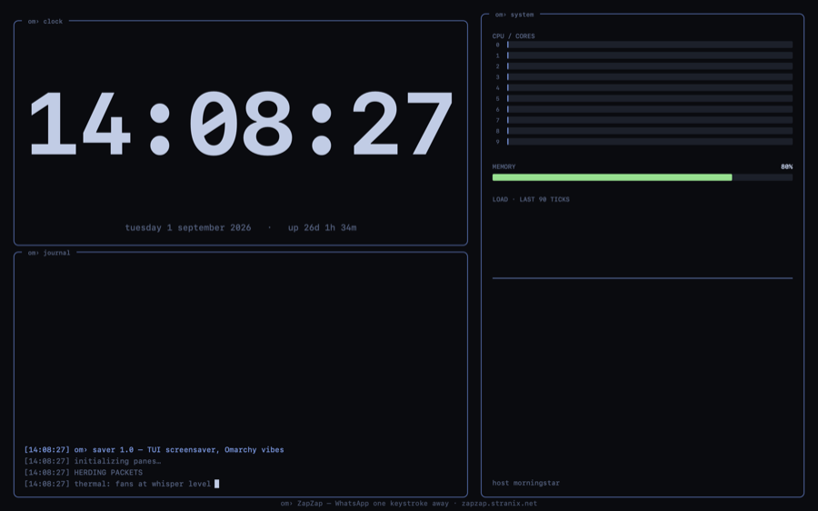

<p align="center">
  
</p>

<h1 align="center">om› saver</h1>

<p align="center">
  <b>A TUI screensaver for macOS. Omarchy vibes, real system stats, zero dependencies.</b><br>
  <sub>Part of the <a href="https://om.stranix.net">OmSuite</a>: small native tools that give your Mac a tiling-WM feel.</sub>
</p>

<p align="center">
  
  
  
  
</p>

---

## What it is

OmSaver turns an idle Mac into a living terminal dashboard: a huge monospace
clock, real telemetry (per-core CPU bars, a memory gauge, a load sparkline,
all sampled live from the kernel) and a scrolling log of carefully fictional
operations (`HERDING PACKETS`, `DEFRAGMENTING THE AETHER`...), in the
[Omarchy](https://omarchy.org) look: dark panes, thin blue borders,
Hyprland-style gaps. One Swift file, AppKit only, no network, about 200 KB.

## Repository layout

```
omsaver/
├── README.md                  <- you are here
├── LICENSE                    <- MIT
├── build.sh                   <- THE whole build: compiles, assembles the
│                                 .saver bundle, signs, installs. No Xcode project.
├── Sources/
│   └── OmSaverView.swift      <- THE whole code: one class, OmSaverView,
│                                 heavily commented. Read this file to
│                                 understand the project.
├── assets/
│   └── omsaver.png            <- the screenshot above
└── build/                     <- produced by build.sh (ignored by git)
    └── OmSaver.saver/         <- the final bundle, ready to install
```

## Build and install

Requirement: Apple's Command Line Tools (`xcode-select --install`), nothing
else. Then:

```console
$ git clone https://github.com/stranix79/omsaver.git
$ cd omsaver
$ ./build.sh install
✓ installed. System Settings > Screen Saver > OmSaver
```

`./build.sh` alone builds `build/OmSaver.saver` without installing it.
No compiler at hand? Download `OmSaver.saver.zip` from the
[Releases](https://github.com/stranix79/omsaver/releases), unzip it,
double-click `OmSaver.saver` and macOS offers to install it.

## How it works on macOS

If you come from C, Python or VB.NET, here are the platform mechanisms this
project illustrates. The source files explain each point in their comments;
this is the overview.

### A .saver is not a program, it is a plugin

There is no `main()` in this project, and that is not an oversight. A macOS
screensaver is a `.saver` **bundle**: a plain folder with an agreed structure
(`Contents/MacOS/` for the binary, `Contents/Info.plist` for the metadata)
that the Finder shows as a single file. The binary inside is a Mach-O of type
*bundle* (`MH_BUNDLE`), the equivalent of a dynamically loadable `.dll`/`.so`,
not an executable.

When the screen goes to sleep, a system process, **`legacyScreenSaver`**,
loads this bundle (through `dlopen`), reads the `NSPrincipalClass` key in the
`Info.plist`, here `OmSaverView` ([build.sh:69](build.sh)), instantiates that
class and hands it a full-screen window. This is why the class carries the
`@objc(OmSaverView)` attribute
([Sources/OmSaverView.swift:40](Sources/OmSaverView.swift)): it pins the name
on the Objective-C runtime side so the string in the plist can find the Swift
class.

Practical consequence: your code never "runs" on its own. The system calls
your methods; you control neither the startup nor the event loop. This is
**inversion of control**, like a custom control in VB.NET whose framework
calls `OnPaint`.

### The life cycle: ScreenSaverView

`OmSaverView` inherits from `ScreenSaverView` (the `ScreenSaver` framework),
which imposes three moments
([Sources/OmSaverView.swift:41](Sources/OmSaverView.swift)):

1. **`init(frame:isPreview:)`**: construction. `isPreview` is `true` when the
   view is the small thumbnail in System Settings: same code, tiny screen
   (hence the `scale` factor computed in `draw`).
2. **`animateOneFrame()`**: called by a system timer at the rate chosen with
   `animationTimeInterval` (here 8 times per second). This is the "game loop":
   update the *state* (sample the CPU, add a log line), then ask for a repaint
   with `needsDisplay = true`.
3. **`draw(_:)`**: called by AppKit when the view must repaint. *Draw* the
   state there, nothing else: separating state from rendering is the rule of
   the framework, because `draw` can be invoked at any time.

Two AppKit traps to know when reading `draw`: drawing is in **immediate mode**
(`setFill()` then `fill()` act on an implicit graphics context, very close to
GDI+), and the coordinate system has its **origin at the bottom left, Y going
up**, the opposite of VB.NET and HTML.

### Real stats: talking to the kernel through Mach

The CPU bars and the RAM gauge are not decorative. The `sampleCPU()` method
([Sources/OmSaverView.swift:129](Sources/OmSaverView.swift)) calls two kernel
C APIs, the macOS equivalent of reading `/proc/stat` and `/proc/meminfo` on
Linux:

- **`host_processor_info`** returns, per core, tick counters *accumulated
  since boot*; the instantaneous load is the difference between two samples.
  The buffer is allocated by the kernel and must be returned by hand
  (`vm_deallocate`): ARC, Swift's memory management, knows nothing about it.
  The `&+`/`&-` operators do modulo arithmetic as in C, because these 32-bit
  counters wrap around and Swift crashes on an ordinary integer overflow.
- **`host_statistics64`** fills a struct of memory page counters; the
  *active + wired + compressed* formula is the one Activity Monitor uses.

### Building without Xcode

`build.sh` replaces a whole Xcode project with 90 lines of shell: two
compilations (`swiftc -emit-object` for arm64 and x86_64, with
`-parse-as-library` telling the compiler there is no `main`), a
`clang -bundle` link that produces the loadable Mach-O, a `lipo` that merges
both architectures into a **universal binary**, the generation of the
`Info.plist`, then a `codesign` **signature**: a developer certificate if the
keychain has one, otherwise an *ad hoc* signature (`--sign -`), enough for
your own machine. Installing is a plain copy: the user's screensavers live in
`~/Library/Screen Savers/`.

## Why is it free?

Because a screensaver is a billboard 😄. OmSaver is the free half of the
**OmSuite**, a series of small paid utilities in the same spirit:

| | | |
|---|---|---|
| **OmFi** | keyboard Wi-Fi panel: scan, join, QR share, DNS switch, graphs | [omfi.stranix.net](https://omfi.stranix.net) |
| **OmDash** | your system's vital signs at a glance | *soon* |
| **OmWin** | the Omarchy shortcuts for your windows | *soon* |

From the same workbench: [ZapZap](https://zapzap.stranix.net) (WhatsApp one
keystroke away) and [Sygnet](https://sygnet.app) (bookmark sync that really
includes Safari). Everything is on [apps.stranix.net](https://apps.stranix.net).

## Privacy

OmSaver reads your CPU/memory statistics locally and displays them. That is
all. No network request, no telemetry, no file written. The "network scans" in
the log are pure theatre.

## By the same author

- [stranix.net](https://stranix.net): the blog.
- [Deckhand](https://deckhand.show): HTML presentations written in Markdown.
- [Chutag](https://chutag.be): QR tags to get your lost items back (beta).
- [apps.stranix.net](https://apps.stranix.net): all the macOS apps, OmSuite included.
- [CODE79](https://code79.com): the devops workshop behind all this.

## License

MIT © 2026 [Stranix](https://apps.stranix.net), Gilles Fauvie.
Made in Belgium, one `swiftc` invocation at a time.

## Support

OmSaver is open source. If it lives on your Mac, you can [sponsor on GitHub](https://github.com/sponsors/stranix79) or [buy me a Red Bull](https://ko-fi.com/stranix). Other ways: [stranix.net/soutenir](https://stranix.net/soutenir/).
